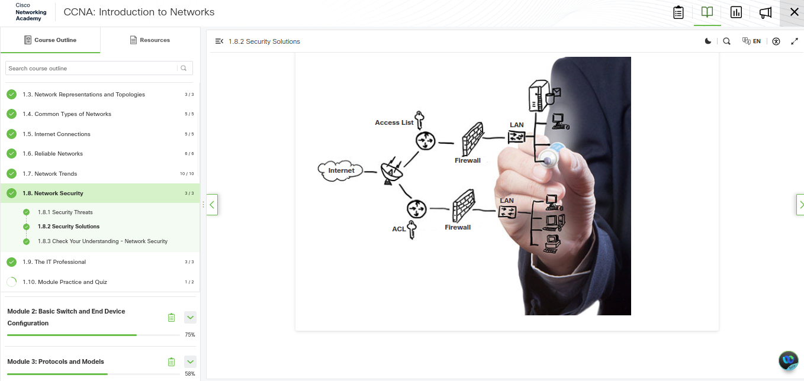
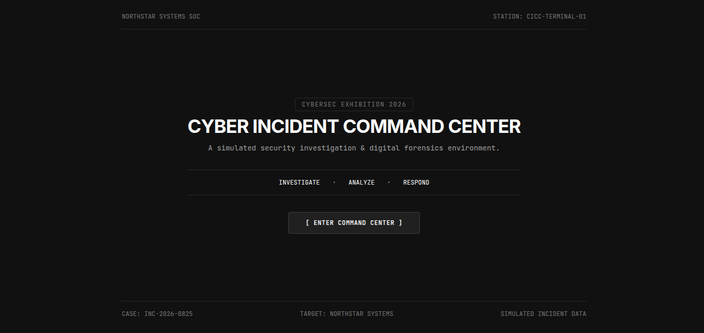
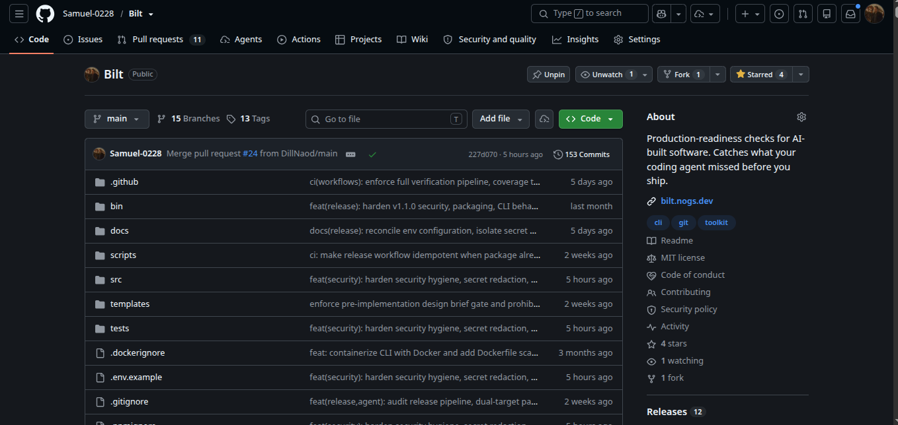
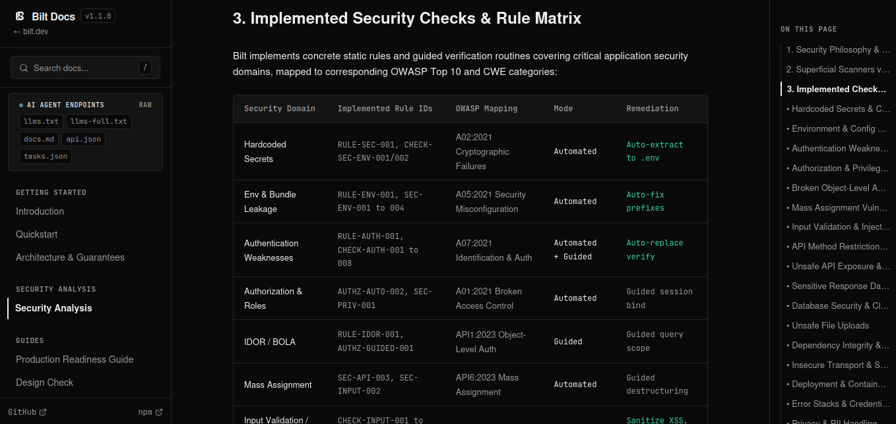

# INSA Summer Camp: Cybersecurity Learning and Skills Progression

This repository documents cybersecurity coursework, hands-on laboratory exercises, vulnerability research, and security engineering projects completed during the INSA Summer Camp.

Rather than presenting these activities as disconnected courses and projects, this documentation records a structured progression of skills. The learning began with foundational networking concepts, moved into practical offensive and defensive security exercises, transitioned into web application vulnerability analysis and CVE research, expanded into structured security analysis, and culminated in practical software implementations through the Incident simulation and the Bilt security toolkit.

## Learning Progression Overview

The learning followed a continuous path where each stage provided the conceptual foundation and practical context required for the next stage:

```text
Cisco CCNA: Introduction to Networks
Foundational knowledge of network devices, protocols, ports, addressing, and packet communication
        |
        v
TryHackMe Hands-on Security Practice
Applying networking knowledge to reconnaissance, Nmap scanning, and offensive and defensive workflows
        |
        v
Web Application Security
Recognizing that proper network configuration does not prevent application-layer logic vulnerabilities
        |
        v
Vulnerability and CVE Research
Analyzing vulnerability causes, exploitation conditions, impact severity, and vendor mitigations
        |
        v
Structured Security Analysis
Formulating defensive questions, mapping attack surfaces, input validation, and OWASP requirements
        |
        v
Practical Implementation: Incident
Simulating a compromised enterprise environment, forensic evidence investigation, and host hardening
        |
        v
Practical Implementation: Bilt
Building automated static analysis tooling to detect security weaknesses in AI-assisted code
```

## 1. Networking Foundation: Cisco CCNA Introduction to Networks

Before investigating security vulnerabilities, I first needed to understand how the systems being secured communicate. Understanding how devices connect, how packets traverse networks, how addressing functions, and how services interact provided the essential foundation for analyzing security problems at both the network and application levels.

This foundation was built through the official Cisco Networking Academy curriculum:

- Course: CCNA: Introduction to Networks (ITN)
- Platform: [Cisco Networking Academy](https://www.netacad.com/)
- Course Information: [CCNA: Introduction to Networks](https://www.netacad.com/courses/networking/ccna-introduction-networks)



The curriculum covered the core areas of network architecture and protocols:

- Network components and architectures: Understanding the roles of hosts, switches, routers, gateways, and transmission media in local and wide area networks.
- LANs and network communication: The mechanics of data transmission across local area networks.
- OSI and TCP/IP models: Layered protocol architectures and the process of data encapsulation and decapsulation across layers.
- Network protocols: How standardized protocols govern communication across different vendors and operating systems.
- Ethernet and switching: Frame formats, switch MAC address tables, and frame forwarding decisions.
- MAC addresses: Layer 2 physical addressing and broadcast domains.
- IPv4 and IPv6: Layer 3 logical addressing structures, address classes, and IPv6 global unicast and link-local addressing.
- Subnetting: Calculating subnet masks, network prefixes, host ranges, and subnet boundaries to segment networks.
- Routing concepts: How routers make packet forwarding decisions between different network segments.
- ARP and IPv6 Neighbor Discovery: Mapping Layer 3 logical IP addresses to Layer 2 physical MAC addresses.
- ICMP: Operational messaging, error reporting, and network reachability testing via echo request and reply.
- TCP and UDP: The distinction between connection-oriented, reliable transport with TCP (three-way handshakes, sequence numbers, acknowledgments, and windowing) and connectionless, lightweight transport with UDP.
- Application-layer protocols: The function and port associations of core protocols, including HTTP, DNS, DHCP, and SSH.
- Basic Cisco IOS configuration: Navigating command modes, managing device configuration files, and configuring interface parameters.
- Router and switch configuration: Initial configuration of hostnames, IP addresses, default gateways, and operational interfaces.
- Network troubleshooting: Structured methodologies for isolating communication failures across protocol layers.
- Network security fundamentals: The Confidentiality, Integrity, and Availability (CIA) triad, security policy principles, and perimeter defense concepts.
- Network threats, vulnerabilities, attacks, and mitigation: Analyzing common threat categories, including unauthorized access, denial of service, malware propagation, and internal threat vectors.
- Basic device security: Hardening management access by replacing unencrypted Telnet with SSH, setting administrative password protections, and implementing port security on switch access ports.
- Building and securing a small network: Designing, configuring, and verifying connectivity and basic security controls across an integrated multi-device topology.

For detailed notes on the networking curriculum, see [network-security.md](network-security.md).

## 2. Connecting Networking Knowledge to Hands-on Practice: TryHackMe

With a solid grasp of protocols, addressing, ports, and traffic flow, I transitioned from theoretical networking into hands-on security laboratories on the TryHackMe platform. 

The CCNA curriculum provided the mental model of how networks function under normal conditions. TryHackMe provided the environment to observe how networks and services behave during security assessments, reconnaissance, and defensive monitoring.

- Platform: [TryHackMe](https://tryhackme.com/)

### Reconnaissance and Service Discovery with Nmap

Network scanning is often introduced as a tool-focused activity, but its effectiveness depends directly on networking fundamentals. In the TryHackMe Nmap laboratory, I applied networking concepts to map target attack surfaces:

- Resource: [TryHackMe - Nmap](https://tryhackme.com/room/furthernmap)
- Status: Completed (100% completion recorded in portal).


The scanning techniques directly reflected the TCP/IP mechanics studied in CCNA:

- IP addresses and host discovery: Using ICMP echo requests, TCP SYN pings, and ARP requests to determine whether target hosts are active on a subnet.
- Port states and protocol behavior: Interpreting port responses based on transport layer mechanics:
  - An open port responds to a TCP SYN packet with a SYN-ACK packet.
  - A closed port responds with a TCP RST packet.
  - A filtered port produces no response or an ICMP unreachable message because an Access Control List (ACL) or firewall dropped the packet.
- Scan switches and methods:
  - TCP SYN stealth scans (`-sS`): Sending SYN packets and terminating handshakes with RST packets before connection completion.
  - TCP connect scans (`-sT`): Completing full three-way handshakes when raw packet crafting privileges are unavailable.
  - Service version detection (`-sV`): Interacting with open ports using application-specific probes to analyze banner responses and determine software versions.
  - Operating system detection (`-O`): Analyzing differences in TCP/IP stack implementations, such as initial TTL values and TCP window sizes.
  - Nmap Scripting Engine (`-sC`): Executing automated scripts to check for standard service misconfigurations.

### System Enumeration and Penetration Testing Workflows

In the Basic Pentesting laboratory, I used reconnaissance findings to explore a complete target system:

- Resource: [TryHackMe - Basic Pentesting](https://tryhackme.com/room/basicpentesting)
- Status: Completed (100% completion recorded in portal).

| Completion Verification | Directory Discovery | User and SSH Enumeration |
| :---: | :---: | :---: |
|  |  |  |

- Service discovery to web exploration: After identifying open HTTP services on the target, I used HTTP path enumeration to discover unlinked application directories, identifying the `/development/` directory.
- Host enumeration: Moving from web access to local operating system inspection, reviewing `/etc/passwd` to identify valid system accounts.
- Configuration inspection: Enumerating user filesystems and locating SSH configuration artifacts (`/home/kay/.ssh`), which demonstrated how weak credential management and file permissions allow lateral movement and privilege escalation.

### Offensive and Defensive Perspectives

To understand security holistically, I explored both offensive and defensive operational viewpoints:

- Offensive Security Introduction:
  - Resource: [TryHackMe - Offensive Security Intro](https://tryhackme.com/room/offensivesecurityintro)
  - Status: Completed (100% completion recorded in portal).
  - Practice: Following an ethical hacker workflow against a target application, mapping the web surface, identifying unlinked administrative pages, and assessing exposed controls.
  - Screenshot: 

- Defensive Security Introduction:
  - Resource: [TryHackMe - Defensive Security Intro](https://tryhackme.com/room/defensivesecurityintro)
  - Status: Completed (100% completion recorded in portal).
  - Practice: Taking the perspective of a Security Operations Center (SOC) analyst, monitoring telemetry, inspecting event logs, correlating traffic anomalies with known attack patterns, and taking containment actions.
  - Screenshot: 

For detailed notes on the laboratory exercises, see [tryhackme.md](tryhackme.md).

## 3. Connecting Network Practice to Web Application Security

Network security and port scanning identify which services are exposed to the network, but security does not end at the network boundary. A system can have properly configured firewalls, correct subnet segmentation, and minimal open ports, yet still be completely vulnerable through the application software running on those open ports.

This marked an important conceptual transition:

```text
Network security -> Service discovery -> Application attack surface -> Web application security
```

When an open HTTP or HTTPS port is discovered, the exposed service is an application runtime (such as an Apache, Nginx, Node.js, or PHP environment). Any flaw in how that application parses input, manages state, or interacts with the underlying operating system becomes a potential entry point into the host.

### PHP Runtime Vulnerability Investigation

I examined this application-level attack surface through the TryHackMe PHP2Shell laboratory:

- Resource: [TryHackMe - PHP2Shell](https://tryhackme.com/room/php2shell)
- Status: In progress (33% room completion verified across initial tasks).


This exercise focused on examining PHP engine features, session handling directives, and file upload parsing:

- Session handling mechanisms: Investigating how PHP tracks session states and how configuration directives such as `session.upload_progress` operate.
- Multipart form parsing: Analyzing how the PHP interpreter processes incoming multipart form data before user scripts begin execution.
- Runtime execution flow: Examining how engine bailout behavior during multipart form parsing can cause temporary files to persist or trigger unexpected code execution sinks, allowing unauthenticated remote code execution (RCE).

This work was not about discovering new vulnerabilities in PHP. It was a hands-on investigation into how subtle runtime behaviors in web interpreters can undermine application security regardless of network-level defenses.

## 4. PHP Vulnerability and CVE Research

Working with runtime flaws led directly to researching published vulnerabilities and standardized vulnerability disclosures.

### Understanding CVE Identifiers

A Common Vulnerabilities and Exposures (CVE) identifier is a standardized, globally unique reference assigned to a publicly disclosed cybersecurity vulnerability. Managed by the CVE Program in partnership with authoritative organizations such as MITRE and the National Institute of Standards and Technology (NIST), CVE records enable security analysts, software engineers, and system administrators to track, prioritize, and remediate weaknesses systematically across disparate systems.

Authoritative references used during this research include:

- CVE Official Program: [CVE.org](https://www.cve.org/)
- Vulnerability Database: [NIST National Vulnerability Database (NVD)](https://nvd.nist.gov/)
- Official Language Security Advisories: [PHP Security Releases](https://www.php.net/security/)

### Researching Vulnerabilities vs. Solving Security Labs

Researching vulnerabilities through formal records is fundamentally different from completing a security laboratory exercise:

- Completing a lab: Focuses on executing a specific sequence of actions against a target to achieve a defined result or capture a flag.
- Vulnerability research: Focuses on analyzing why the vulnerability exists at the code or architecture level, which software versions are affected, what environmental conditions make exploitation possible, how severity is scored using the Common Vulnerability Scoring System (CVSS), and how developers can patch the underlying flaw or apply defensive configuration workarounds.

### The Vulnerability Analysis Progression

During this research, I applied a structured five-step analysis model:

```text
1. Finding a vulnerability
   Identify an unexpected behavior, security advisory, or CVE record.
   
2. Understanding why it exists
   Analyze the code, configuration default, or parser edge case that produces the weakness.
   
3. Understanding how it can be exploited
   Determine the exact technical conditions, input payloads, and privileges required to trigger it.
   
4. Understanding its impact
   Evaluate the potential damage to confidentiality, integrity, and availability using CVSS metrics.
   
5. Understanding how it can be mitigated
   Identify code fixes, input sanitization, configuration changes, or architectural boundaries to resolve it.
```

Rather than fabricating an unverified list of CVE numbers, this research centered on analyzing verified PHP runtime mechanics, session handling routines, and published security advisories documented on [CVE.org](https://www.cve.org/) and [PHP.net](https://www.php.net/security/).

For detailed notes on vulnerability concepts, see [web-security.md](web-security.md).

## 5. Connecting Vulnerability Research to Security Analysis

Combining networking fundamentals, hands-on security exercises, and vulnerability research changed how I approached system evaluation. Instead of only asking the basic offensive question:

> "Can this system be attacked?"

the learning led me to ask structured defensive and analytical questions:

- What attack surface is exposed to untrusted inputs?
- What components and dependencies are vulnerable?
- Why is the vulnerability present in the code or configuration?
- What actions could an attacker execute if this weakness is exploited?
- What validation boundaries should be enforced on incoming data?
- How can the weakness be mitigated at both the code and architecture levels?
- How can these security checks be repeated automatically during development?

This mindset connected directly to industry frameworks, application security principles, and defensive design patterns:

### Attack Surface and Vulnerability Analysis

Evaluating a system requires mapping all external interfaces, including open network ports, exposed API endpoints, accepted file upload formats, and user-supplied input parameters. Identifying where untrusted data enters the application defines the boundaries where security checks must be enforced.

### OWASP Guidance

The Open Worldwide Application Security Project (OWASP) provides structured guidelines and vulnerability taxonomies widely used in industry:

- [OWASP Foundation](https://owasp.org/)
- [OWASP Top 10](https://owasp.org/www-project-top-ten/): Highlighting critical flaw categories such as Broken Access Control (A01), Cryptographic Failures (A02), Injection (A03), and Identification and Authentication Failures (A07).
- [OWASP Web Security Testing Guide (WSTG)](https://owasp.org/www-project-web-security-testing-guide/): Providing testing methodologies for evaluating application security controls.

### Mass Assignment Vulnerabilities

Mass assignment occurs when web application frameworks automatically bind client-supplied request parameters directly to internal data models or database records without an explicit field allowlist:

- The Mechanism: When an application passes `req.body` directly to an ORM update call, an attacker can append unadvertised parameters to the payload.
- The Impact: If the underlying model contains privileged attributes such as `role`, `isAdmin`, or `accountBalance`, an unauthorized user can elevate their privileges.
- Mitigation Guidance: Following the [OWASP Mass Assignment Cheat Sheet](https://cheatsheetseries.owasp.org/cheatsheets/Mass_Assignment_Cheat_Sheet.html), applications must enforce strict Data Transfer Objects (DTOs), schema validation (using tools like Zod or Joi), and explicit parameter destructuring prior to database persistence.

### Input Validation and Injection Defense

Applications must treat all client-supplied data as untrusted. Without strict validation, malicious input can reach critical execution sinks, leading to SQL Injection, Command Injection, Path Traversal, and Cross-Site Scripting (XSS).

Following the [OWASP Input Validation Cheat Sheet](https://cheatsheetseries.owasp.org/cheatsheets/Input_Validation_Cheat_Sheet.html), defenses require:

- Positive validation (allowlists) enforcing expected data types, character sets, and lengths.
- Parameterized queries and prepared statements to separate code from data.
- Context-aware output encoding to prevent script injection in web responses.

### Security Automation

Manual security code review is error-prone and difficult to sustain across rapidly changing codebases. The final step in this analytical progression was recognizing that defensive checks, secret detection, and data-flow validation must be automated as part of the developer workflow.

## 6. Practical Application: Incident (Security Incident Simulation)

To apply these concepts in a practical project, I developed the **Cyber Incident Command Center** (Incident):

- Project Repository: [https://github.com/Samuel-0228/Incident](https://github.com/Samuel-0228/Incident)
- Technical Report: [Incident.md](Incident.md)

Incident is an interactive cyber incident investigation simulator built with React 18, TypeScript, and Tailwind CSS. It was developed to model how a compromised enterprise system is investigated, analyzed, and secured.



### How Earlier Stages Supported Incident

Building Incident brought together knowledge from across the summer camp:

- Networking knowledge from CCNA provided the basis for modeling internal corporate subnets (`10.42.18.0/24` for workstations, `10.42.10.0/24` for servers), default gateway routing, Active Directory domain controllers (`DC-01`), internal file servers (`FILE-01`), and external command and control (C2) hosts.
- Hands-on security exercises provided practical experience with how real intrusions progress, enabling me to model a realistic eight-stage attack sequence: initial spear-phishing delivery (`Payroll_Update.xlsm`), macro execution, credential harvesting from memory, unauthorized Kerberos and NTLM authentication, lateral movement via SMB, persistence creation, data staging, and HTTPS exfiltration.
- Vulnerability research informed the design of the technical artifacts, such as email headers with SPF authentication failures, Windows security event logs (Event IDs 4768 and 4624), and malware process trees (`EXCEL.EXE` spawning `cmd.exe`, `powershell.exe`, and `updater.exe`).
- Defensive security concepts guided the development of the containment decision engine, demonstrating why partial mitigations (such as blocking a single perimeter IP address) fail if active persistence mechanisms remain on compromised internal endpoints.

The project is an educational simulation designed to practice incident response workflows and system hardening rather than a production security platform.

## 7. Practical Application: Bilt (Automated Security Tooling)

The culmination of my security learning was the development of **Bilt**, a security CLI toolkit designed to analyze and enforce security standards in software developed with AI coding assistants:

- Documentation: [https://bilt.nogs.dev/docs#security-analysis](https://bilt.nogs.dev/docs#security-analysis)
- Source Repository: [https://github.com/Samuel-0228/bilt](https://github.com/Samuel-0228/bilt)
- Package on npm: [https://www.npmjs.com/package/bilt-toolkit](https://www.npmjs.com/package/bilt-toolkit)
- Technical Report: [bilt.md](bilt.md)



### The Problem Bilt Addresses

AI coding agents (such as Claude Code, Cursor, Windsurf, and Antigravity) generate code rapidly. However, they frequently overlook foundational security patterns: hardcoding sensitive API keys, exposing server secrets into client-side build bundles, using unverified JWT decoding methods, or binding raw request payloads directly to database update operations.

Bilt was created to operationalize application security knowledge into an automated developer verification tool that runs directly in the terminal or CI/CD pipelines before code is deployed.

### How Earlier Learning Supported Bilt

Each stage of the summer camp contributed directly to Bilt's architecture:

- CCNA provided the protocol and communication foundation necessary to understand data movement and network boundaries.
- TryHackMe provided practical exposure to how attackers identify exposed secrets, enumerate services, and exploit application misconfigurations.
- PHP and CVE research reinforced the importance of deterministic, build-time static checks to catch vulnerable patterns before they reach runtime environments.
- OWASP standards provided the structured taxonomy for categorizing Bilt's rule engine, including Cryptographic Failures, Broken Access Control, Injection, and Identification Failures.

### Capabilities Implemented in Bilt

Bilt relies on deterministic static analysis rules rather than subjective AI evaluations:

- Abstract Syntax Tree (AST) Parsing: Uses Babel AST parsers to inspect code syntax trees, function invocations, and module import declarations.
- Shannon Entropy Calculation: Analyzes string entropy ($H > 4.5$ bits/char) alongside regex signatures across 30+ service provider patterns to detect hardcoded API keys and credentials.
- Data Flow Tracking: Traces parameters from untrusted HTTP request sources (`req.body`, `req.query`, `req.params`) to database sinks (`prisma`, `db.query`, ORM models) to flag unconstrained mass assignment.
- CLI Execution Commands:
  - `npx bilt check`: Runs deterministic static checks against the local codebase.
  - `npx bilt scan`: Performs deeper security and dependency analysis.
  - `npx bilt doctor`: Diagnoses configuration errors and missing environment files.
  - `npx bilt fix --safe`: Applies safe automated remediations, such as extracting exposed secrets to `.env` files.



- Automated Rules vs. Guided Review:
  - Automated Hard Gates: Hardcoded secrets (`RULE-SEC-001`), client-side environment leakage (`RULE-ENV-001`), unverified token decoding (`RULE-AUTH-001`), and mass assignment on database updates (`SEC-API-003`).
  - Guided Review Checks: Broken Object-Level Authorization (`RULE-IDOR-001`) and unsafe file upload handling (`CHECK-UPLOAD-GUIDED-001`), which prompt human developer review rather than generating false-positive gate failures.

## Skills Progression

The learning activities completed during the INSA Summer Camp represent a coherent progression across five core competencies:

### 1. Network Fundamentals
Understanding how network devices, architectures, protocols, packet encapsulation, and communication services operate across local and wide area environments.

### 2. Network and Security Practice
Applying networking knowledge to hands-on security laboratories to perform active reconnaissance, Nmap port scanning, service enumeration, offensive workflows, and defensive log analysis.

### 3. Vulnerability Analysis
Investigating PHP runtime behaviors and standardized CVE records to determine root causes, affected components, exploitation prerequisites, and vendor mitigations.

### 4. Security Research
Using authoritative documentation, vulnerability databases (CVE.org, NIST NVD), and industry standards (OWASP Top 10, WSTG) to analyze application weaknesses and establish secure implementation patterns.

### 5. Security Engineering
Applying theoretical knowledge and analytical habits to practical implementations: developing the Incident simulation environment and building Bilt to automate deterministic security checks in software projects.

## Repository Documentation Index

This repository contains the following detailed technical reports:

| Document | Description |
| :--- | :--- |
| [network-security.md](network-security.md) | Cisco Networking Academy CCNA ITN coursework, network architecture, and perimeter defense concepts. |
| [tryhackme.md](tryhackme.md) | Hands-on laboratory notes covering Basic Pentesting, Nmap scanning, offensive and defensive fundamentals, and PHP2Shell. |
| [web-security.md](web-security.md) | Exploration of web application weaknesses, OWASP standards, mass assignment, input validation, and CVE research. |
| [Incident.md](Incident.md) | Technical report on the Cyber Incident Command Center simulation, forensic workflows, and system hardening. |
| [bilt.md](bilt.md) | Architecture and technical overview of the Bilt static analysis security toolkit for AI-assisted development workflows. |

## Ethical Standards and Scope

This repository documents academic learning resources, laboratory exercises, and original developer tooling:

- Platform Compliance: In strict adherence to TryHackMe and Cisco Networking Academy terms of service, this repository does not publish challenge solutions, exercise answers, proprietary course materials, or capture-the-flag flags.
- Authorized Environments: All reconnaissance and exploitation activities described were conducted exclusively against intentionally vulnerable virtual environments within authorized training laboratories.
- Educational Scope: The tooling and documentation produced serve to strengthen defensive security posture and apply security concepts through software engineering.
