# INSA Cybersecurity Summer Camp — Technical Portfolio & Research Documentation

[](#)
[](#)
[](#)
[](https://www.npmjs.com/package/bilt-toolkit)
[](https://github.com/Samuel-0228/Incident)

This repository serves as a comprehensive technical portfolio documenting cybersecurity coursework, hands-on penetration testing and defensive labs, web application security research, and practical security engineering tooling developed during the **INSA Summer Camp**.

---

## 📌 Executive Summary & Progress Dashboard

The curriculum combined structured academic networking coursework, hands-on offensive and defensive cybersecurity labs, vulnerability analysis, and the creation of developer-focused security software:

| Domain / Project | Platform / Scope | Status | Key Focus & Competencies |
| :--- | :--- | :--- | :--- |
| **Network Security** | [Cisco Networking Academy](https://www.netacad.com/) (CCNA ITN) | **Verified Coursework** | Network architectures, CIA triad, threat vectors, ACLs, stateful firewalls, device hardening. |
| **Basic Pentesting** | [TryHackMe](https://tryhackme.com/room/basicpentesting) | **100% Completed** | Service enumeration, web directory fuzzing (`/development/`), Linux user reconnaissance (`/etc/passwd`), SSH lateral movement. |
| **Nmap Network Scanning** | [TryHackMe](https://tryhackme.com/room/furthernmap) | **100% Completed** | SYN stealth (`-sS`), service fingerprinting (`-sV`), OS detection (`-O`), port state evaluation, NSE scripting. |
| **Defensive Security** | [TryHackMe](https://tryhackme.com/room/defensivesecurityintro) | **100% Completed** | SOC operations, SIEM telemetry, log correlation, anomalous request detection, incident containment. |
| **Offensive Security** | [TryHackMe](https://tryhackme.com/room/offensivesecurityintro) | **100% Completed** | Ethical hacking methodology, web attack surface mapping, unlinked administrative interface discovery. |
| **PHP2Shell Research** | [TryHackMe](https://tryhackme.com/room/php2shell) | **In Progress (33%)** | PHP runtime vulnerability analysis (CVE-2026-109618 / 109619), `session.upload_progress` exploitation, unauthenticated RCE. |
| **Web Security Research** | OWASP & CVE Standards | **Documented** | OWASP Top 10, mass-assignment remediation (DTOs, schemas), input validation allowlisting, CVE tracking (MITRE/NVD). |
| **Bilt Security Toolkit** | [npm (`bilt-toolkit`)](https://www.npmjs.com/package/bilt-toolkit) / [GitHub](https://github.com/Samuel-0228/bilt) | **Active Tooling** | Deterministic AST static analysis, Shannon entropy secret detection ($H > 4.5$), data-flow tracking, AI-agent code auditing. |
| **Incident Command Center** | [GitHub (`Incident`)](https://github.com/Samuel-0228/Incident) | **Interactive Simulation** | Incident investigation workbench: event triage, timeline analysis, malware sandbox, network topology, ATT&CK mapping. |

---

## 🧭 Repository Structure & File Index

The documentation in this repository is modularized into specialized technical reports:

```text
Report-docs/
├── README.md                 # Master portfolio overview, metrics, and documentation index
├── network-security.md       # Cisco Networking Academy CCNA ITN coursework & network defense
├── tryhackme.md              # Hands-on offensive, defensive, and runtime vulnerability labs
├── web-security.md           # OWASP standards, mass-assignment mechanics, and CVE research
├── bilt.md                   # Bilt CLI security toolkit architecture, AST checks, and usage
└── screenshots/              # Verified lab completion evidence and system architecture captures
    ├── cisco-network-security.png
    ├── tryhackme-basic-pentesting.png
    ├── tryhackme-basic-pentesting-dir-discovery.png
    ├── tryhackme-basic-pentesting-ssh-enumeration.png
    ├── tryhackme-nmap.png
    ├── tryhackme-defensive-security-intro.png
    ├── tryhackme-offensive-security-intro.png
    ├── tryhackme-php2shell.png
    ├── bilt-repository.png
    ├── bilt-security-matrix.png
    └── incident-command-center.png
```

- 📖 **[Network Security Documentation](network-security.md)**: CCNA ITN modules, network threats, and perimeter protection concepts.
- 📖 **[TryHackMe Hands-on Lab Notes](tryhackme.md)**: Technical summaries of penetration testing, scanning, defensive monitoring, and runtime exploitation.
- 📖 **[Web Application Security & Vulnerability Research](web-security.md)**: Deep dive into OWASP standards, unconstrained parameter binding, input validation defenses, and CVE tracking.
- 📖 **[Bilt Security Tooling Documentation](bilt.md)**: Technical architecture of the Bilt static analysis engine, entropy calculations, and AST gate enforcement.

---

## 🛡️ Detailed Focus Areas & Technical Deep Dives

### 1. Network Security & Perimeter Architecture

Documented in detail in **[network-security.md](network-security.md)**.

Studied through the **Cisco Networking Academy** curriculum (**CCNA: Introduction to Networks (ITN)**), focusing on foundational network protocols, network topologies, switch configuration, and defensive controls.


#### Core Technical Modules:
- **Network Security Fundamentals (Module 1.8)**: The Confidentiality, Integrity, and Availability (CIA) triad; analyzing attack surfaces across Local Area Networks (LAN) and Wide Area Networks (WAN).
- **Threat Vector Analysis (Module 1.8.1)**: Evaluating attack patterns including unauthorized access, credential stuffing, distributed denial of service (DDoS), malware propagation, and insider threats.
- **Perimeter Defense Principles (Module 1.8.2)**: Deployment of packet-filtering rules, Access Control Lists (ACLs), stateful inspection firewalls, and demilitarized zones (DMZs) with network segmentation.
- **Device Hardening (Module 2)**: Hardening Cisco Catalyst switches and routers, configuring encrypted management channels (SSH over Telnet), disabling unused ports, implementing port security, and enforcing strong password hashing.

---

### 2. Hands-on Security Exercises (TryHackMe)

Documented in detail in **[tryhackme.md](tryhackme.md)**.

Practical exercises performed on virtual targets across offensive reconnaissance, target exploitation, log forensics, and runtime flaw evaluation:

#### A. Basic Pentesting (100% Completed)
- **Target Assessment**: Virtual machine simulating vulnerable web application infrastructure on Linux.
- **Web Reconnaissance**: Conducted directory brute-forcing and content discovery, identifying the hidden `/development/` directory returning HTTP 200.
- **System Enumeration**: Post-access inspection of `/etc/passwd` to map system user profiles.
- **Privilege Escalation & Lateral Movement**: Enumerated user filesystem hierarchies, uncovering sensitive SSH configuration artifacts (`/home/kay/.ssh`).

| Completion Verification | Directory Discovery | User & SSH Enumeration |
| :---: | :---: | :---: |
|  |  |  |

#### B. Nmap Network Scanning (100% Completed)
- **Scanning Methodologies**: Evaluated the mechanics of SYN stealth scans (`-sS`), full three-way TCP connect scans (`-sT`), and UDP scanning (`-sU`).
- **Service & Host Fingerprinting**: Deployed service version detection (`-sV`) and operating system detection (`-O`) to map target network attack surfaces.
- **Nmap Scripting Engine (NSE)**: Executed targeted discovery and vulnerability scripts (`-sC`) to enumerate banners and identify misconfigurations.


#### C. Defensive Security Fundamentals (100% Completed)
- **Security Operations Center (SOC)**: Practical exposure to SIEM telemetry, alert triage, and incident lifecycle management.
- **Log Correlation & Analysis**: Analyzed server event logs to isolate malicious request bursts, brute-force indicators, and unauthenticated administrative access attempts.
- **Incident Mitigation**: Executed tactical mitigation measures to isolate compromised endpoints and contain malicious traffic.


#### D. Offensive Security Introduction (100% Completed)
- **Ethical Hacker Workflow**: Practiced systematic progression through reconnaissance, vulnerability identification, and target exploitation.
- **Web Attack Surface Evaluation**: Uncovered unlinked administrative endpoints through structured URL path enumeration.


#### E. PHP2Shell Runtime Vulnerability Research (In Progress - 33%)
- **Target Analysis**: Investigated the underlying C implementation and runtime mechanisms of the PHP engine.
- **Vulnerability Mechanics**: Evaluated **CVE-2026-109618** and **CVE-2026-109619** involving `session.upload_progress` directives.
- **Exploitation Vector**: Analyzed how engine bailout behavior during multipart/form-data parsing creates conditions for unauthenticated Remote Code Execution (RCE).


---

### 3. Web Application Security & Vulnerability Research

Documented in detail in **[web-security.md](web-security.md)**.

Research centered on modern web application flaw categories, industry security frameworks, and defensive engineering patterns:

#### OWASP Framework Alignment
- **OWASP Top 10**: Structured study of Broken Access Control (A01), Cryptographic Failures (A02), Injection (A03), and Identification/Authentication Failures (A07).
- **Web Security Testing Guide (WSTG)**: Utilizing standard penetration testing methodologies to verify authentication, session management, and data-validation controls.

#### Mass Assignment Mechanics & Defense
- **The Vulnerability**: Web frameworks automatically binding untrusted HTTP request payloads (`req.body`, URL params) directly into ORM entities or database update queries without explicit attribute allowlists.
- **Impact**: Attackers can inject privileged model properties (e.g., `isAdmin: true`, `role: "superuser"`, `balance: 99999`) into standard profile update requests.
- **Defensive Engineering**:
  - Utilizing Data Transfer Objects (DTOs) with strict schema validation libraries (e.g., Zod, Joi).
  - Explicit destructuring and property allowlisting prior to persistence layer operations.
  - Configuring ORM schema boundaries to reject unmapped fields.

#### Input Validation & Injection Mitigation
- Enforcing strict positive validation (allowlists) at application trust boundaries.
- Contextual output encoding and parameterized interfaces to eliminate SQL Injection (SQLi), Command Injection, Path Traversal, and Cross-Site Scripting (XSS).

#### Vulnerability Tracking Standards
- **CVE Program**: Understanding standardized vulnerability tracking, CNA designations, and vulnerability disclosure lifecycles managed by MITRE.
- **NIST National Vulnerability Database (NVD)**: Analyzing Common Vulnerability Scoring System (CVSS v3/v4) vector strings, severity metrics, and Common Weakness Enumeration (CWE) mappings.

---

### 4. Practical Security Engineering & Tooling Projects

#### Project A: Bilt — Developer Security Toolkit (`bilt-toolkit`)

Documented in detail in **[bilt.md](bilt.md)**.

- **Package**: [`bilt-toolkit` on npm](https://www.npmjs.com/package/bilt-toolkit)
- **Repository**: [github.com/Samuel-0228/bilt](https://github.com/Samuel-0228/bilt)
- **Documentation**: [bilt.nogs.dev/docs#security-analysis](https://bilt.nogs.dev/docs#security-analysis)

Bilt is a security CLI toolkit built to detect security oversights and architectural vulnerabilities in codebases generated by AI coding assistants (Claude Code, Cursor, Windsurf, Antigravity) and human software engineering teams.


##### Architectural Capabilities:
- **Abstract Syntax Tree (AST) Inspection**: Uses Babel AST parsers and visitor walks to traverse code structures and identify unsafe API usage patterns.
- **Shannon Entropy Analysis**: Computes character entropy ($H > 4.5$ bits/char) combined with regex signatures across 30+ service provider patterns to detect hardcoded API keys and secrets.
- **Data-Flow Taint Tracking**: Traces parameters from untrusted request inputs (`req.body`, `req.query`, `req.params`) down to database query sinks to identify unconstrained mass-assignment and missing validation.
- **Deterministic Gate Enforcement**: AI does not dictate pass/fail decisions; rules are strictly deterministic, with AI used solely for remediation explanations (`bilt explain`).


##### Core CLI Commands:
```bash
# Run deterministic static checks across the codebase
npx bilt check

# Perform deep security and dependency scanning
npx bilt scan

# Diagnose configuration issues, environment risks, and missing files
npx bilt doctor

# Apply non-destructive automated remediations (e.g., extract exposed secrets to .env)
npx bilt fix --safe
```

##### Automated Gates vs. Guided Review:
- **Automated Hard Gates**:
  - `RULE-SEC-001` / `CHECK-SEC-ENV-001`: High-entropy hardcoded secrets and API keys.
  - `RULE-ENV-001`: Client-side bundling leakage of private environment secrets (`NEXT_PUBLIC_`, `VITE_`).
  - `RULE-AUTH-001`: Insecure token decoding (`jwt.decode()` invoked without `jwt.verify()`).
  - `SEC-API-003`: Mass-assignment vulnerabilities on database write operations.
  - `RULE-INPUT-001`: Dynamic string concatenation in SQL and command execution sinks.
- **Guided Review Checks**:
  - `RULE-IDOR-001`: Broken Object-Level Authorization review prompts.
  - `CHECK-UPLOAD-GUIDED-001`: Unrestricted file upload validation checks (MIME verification, upload paths, size limits).

---

#### Project B: Cyber Incident Command Center (`Incident`)

- **Repository**: [github.com/Samuel-0228/Incident](https://github.com/Samuel-0228/Incident)
- **Technology Stack**: React 18, TypeScript, Tailwind CSS, Lucide Icons, Vite

The **Cyber Incident Command Center** is an interactive incident investigation and digital forensics simulation environment developed to model real-world SOC detection, triage, analysis, and response workflows.


##### Key Features & Workstation Modules:
- **Incident Telemetry & Overview**: Real-time visualization of attack severity, affected infrastructure, and containment status.
- **Incident Timeline**: Chronological event correlation across network, endpoint, and identity logs.
- **Evidence Explorer**: Interactive inspection of forensic artifacts including PCAP network captures, Linux authentication logs, and disk images.
- **Malware Simulator & Sandbox**: Behavioral observation of simulated malicious payloads, persistence mechanisms, and command-and-control (C2) beacons.
- **Network Topology & Endpoint Inventory**: Dynamic mapping of network nodes, subnets, open ports, and identity privileges.
- **MITRE ATT&CK Tracker**: Visual mapping of observed threat actor techniques across Initial Access, Execution, Persistence, Privilege Escalation, and Exfiltration.
- **Containment Decision Engine**: Interactive decision points for isolating subnets, revoking credentials, or deploying firewall rules.
- **Final Incident Reporting**: Generates structured post-incident forensic reports and remediation recommendations.

---

## 💡 Core Competencies & Skills Acquired

```mermaid
graph TD
    A[Cybersecurity Core Competencies] --> B[Network Security]
    A --> C[Offensive Security & Pentesting]
    A --> D[Defensive Security & SOC Operations]
    A --> E[Software Security & Tooling Engineering]

    B --> B1[Perimeter Architecture & Firewalls]
    B --> B2[Cisco Switch Hardening & Protocols]
    B --> B3[Network Segmentation & ACLs]

    C --> C1[Nmap Active Reconnaissance]
    C --> C2[Web Directory & Service Fuzzing]
    C --> C3[Linux Privilege Escalation & SSH Recon]
    C --> C4[PHP Runtime Vulnerabilities CVE RCE]

    D --> D1[SIEM Log Telemetry & Event Correlation]
    D --> D2[Incident Response & Threat Containment]
    D --> D3[Forensic Artifact Investigation]

    E --> E1[AST Static Analysis Engine Babel]
    E --> E2[Shannon Entropy Secret Detection]
    E --> E3[OWASP Top 10 & Mass Assignment Defense]
    E --> E4[Interactive Forensics Simulator Dev]
```



---

## 📜 Ethical Standards & Responsible Disclosure

This repository documents academic learning resources, practical laboratory exercises, and original developer tooling:

1. **Adherence to Platform Terms**: In strict compliance with TryHackMe and Cisco Networking Academy terms of service, this repository does not publish challenge solutions, exercise answers, proprietary course materials, or capture-the-flag (CTF) flags.
2. **Authorized Environments Only**: All reconnaissance and exploitation techniques described were conducted exclusively against intentionally vulnerable virtual environments within authorized training laboratories.
3. **Safe Engineering**: Tooling developed (such as Bilt) is engineered to strengthen defensive posture and prevent vulnerability introduction in modern software pipelines.

---

## 🔗 Quick Links

- [Network Security Documentation](network-security.md)
- [TryHackMe Lab Writeups & Summary](tryhackme.md)
- [Web Security & Vulnerability Research](web-security.md)
- [Bilt Security Tooling Overview](bilt.md)
- [Bilt Documentation](https://bilt.nogs.dev/docs#security-analysis)
- [Bilt on npm](https://www.npmjs.com/package/bilt-toolkit)
- [Bilt GitHub Repository](https://github.com/Samuel-0228/bilt)
- [Cyber Incident Command Center GitHub Repository](https://github.com/Samuel-0228/Incident)
