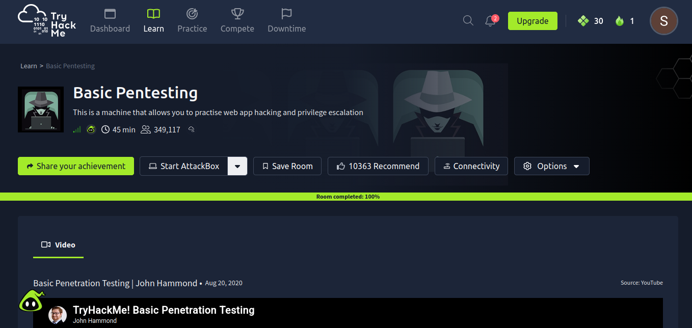
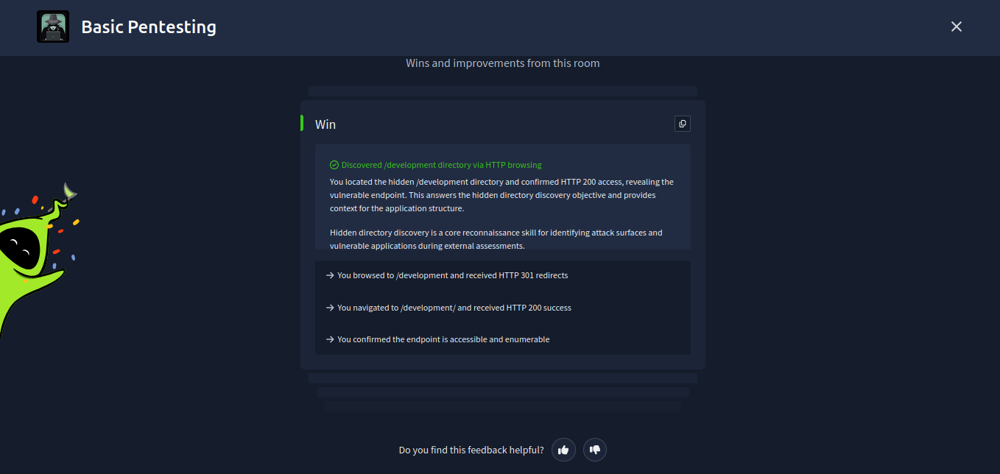
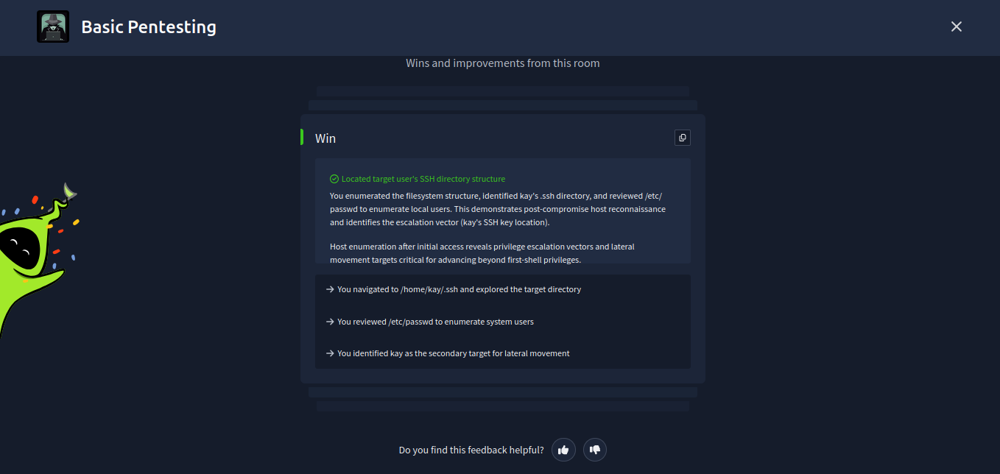
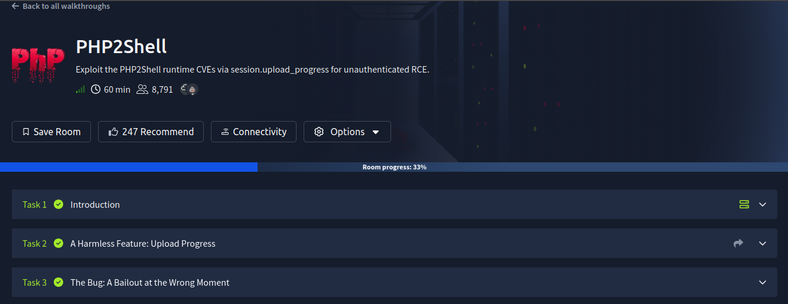
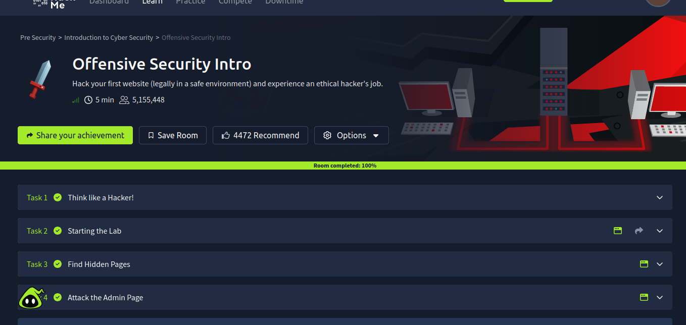
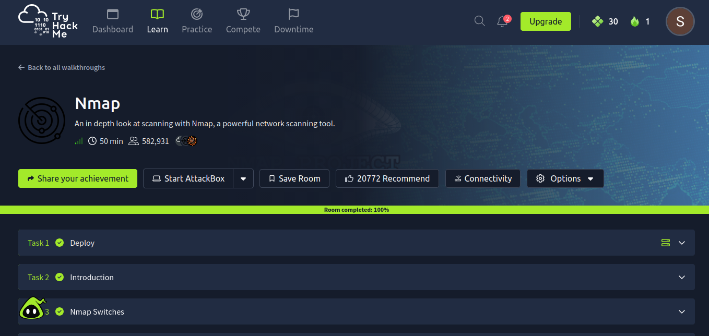
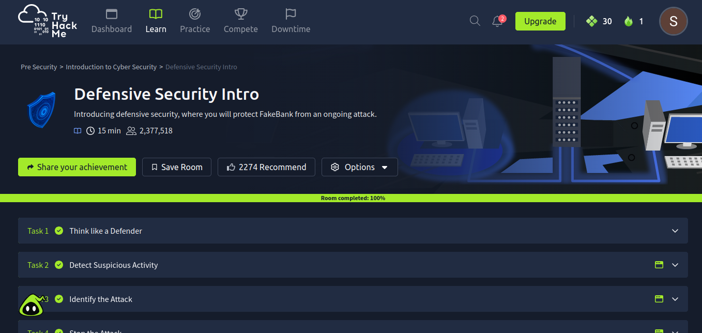

# TryHackMe Hands-on Exercises

## Overview

This section records hands-on cybersecurity exercises completed and explored on the TryHackMe platform as part of the INSA Summer Camp skills-focused track. The exercises span introductory offensive security methodology, network reconnaissance, web application weakness identification, local privilege escalation, runtime vulnerability exploitation, and defensive log analysis.

## Exercises

### Basic Pentesting

- Resource: [TryHackMe - Basic Pentesting](https://tryhackme.com/room/basicpentesting)
- Focus: A virtual lab machine designed to practice fundamental penetration testing techniques, web application reconnaissance, and Linux privilege escalation.
- Status: Completed (100% completion recorded in portal).
- Skills practiced:
  - Web service reconnaissance: Identifying accessible endpoints and enumerating hidden directories (discovered the `/development/` directory and confirmed HTTP 200 response).
  - Post-compromise local host reconnaissance: Reviewing `/etc/passwd` to enumerate local system user accounts.
  - Target structure exploration: Navigating filesystem layouts and identifying the target user's SSH configuration (`/home/kay/.ssh`) for lateral movement and privilege escalation analysis.

---

### PHP2Shell

- Resource: [TryHackMe - PHP2Shell](https://tryhackme.com/room/php2shell)
- Focus: Exploitation of PHP runtime vulnerabilities (CVE-2026-109618 and CVE-2026-109619) via `session.upload_progress` mechanisms to obtain unauthenticated remote code execution (RCE).
- Status: In progress (33% room completion verified across initial tasks).
- Skills practiced:
  - Investigating PHP engine features, session handling mechanisms, and upload progress tracking directives.
  - Analyzing how runtime bailout behavior during multipart form parsing can lead to file manipulation and execution of arbitrary code without application-level authentication.

---

### Offensive Security Intro

- Resource: [TryHackMe - Offensive Security Intro](https://tryhackme.com/room/offensivesecurityintro)
- Focus: Introductory offensive security lab exploring an ethical hacker's workflow against an exposed target web application.
- Status: Completed (100% completion recorded in portal).
- Skills practiced:
  - Adopting an offensive security evaluation mindset to identify application weaknesses.
  - Using directory enumeration techniques to uncover unlinked administrative pages.
  - Interacting with exposed administrative interfaces to evaluate access controls.

---

### Nmap

- Resource: [TryHackMe - Nmap](https://tryhackme.com/room/furthernmap)
- Focus: In-depth exploration of network scanning, host discovery, and port enumeration using the Nmap network scanner.
- Status: Completed (100% completion recorded in portal).
- Skills practiced:
  - Host discovery, port state interpretation (open, closed, filtered), and port range targeting.
  - Configuring Nmap command-line switches for SYN stealth scans, TCP connect scans, service version detection (`-sV`), and OS fingerprinting (`-O`).
  - Network reconnaissance methodology to map attack surfaces before vulnerability assessment.

---

### Defensive Security Intro

- Resource: [TryHackMe - Defensive Security Intro](https://tryhackme.com/room/defensivesecurityintro)
- Focus: Introduction to defensive security operations, Security Operations Center (SOC) roles, log analysis, and incident mitigation in response to simulated cyber attacks.
- Status: Completed (100% completion recorded in portal).
- Skills practiced:
  - Developing a defensive mindset focused on system monitoring and incident containment.
  - Inspecting event logs to detect suspicious activity, anomalous request volume, and unauthorized access attempts.
  - Identifying active attack vectors and executing incident response steps to defend critical application assets.

## Learning Takeaways

The hands-on exercises provided practical experience across four primary domains:

- Reconnaissance and service discovery: Conducting structured active scanning with Nmap and using HTTP enumeration to discover unlinked application endpoints.
- Penetration testing workflows: Progressing from external reconnaissance to initial access points and post-compromise host analysis.
- Web application weaknesses: Evaluating attack surfaces on web interfaces, assessing parameter handling, and studying runtime-level interpreter flaws.
- Defensive security practices: Interpreting security event logs, correlating anomalous traffic with attack techniques, and understanding the role of SOC incident response workflows.

In accordance with ethical guidelines and platform rules, this repository does not include challenge walkthroughs, flag values, or exercise solutions.
